# Kīlauea · Der ganze Vulkan

Der Kīlauea auf Hawaiʻi als begehbare und befliegbare 3D-Landschaft auf der Grafikkarte, vom Gipfel bis unter das Meer:
die Caldera Kaluapele mit dem Halemaʻumaʻu, Lavasee und Fontänen, zwei Riftzonen mit Grubenkratern und Spalten, die
Chain of Craters Road hinab zur Küste, Lava, die ins Meer fällt und unter Wasser zu Kissen erstarrt, Regenwald und
Wüste, Mauna Loa und Mauna Kea, darunter das Magmasystem. Java 21, JOGL 2.6 (OpenGL 4.3), Swing mit `FStyle`,
wahlweise mit Oracle 21c (Schema `KILAUEA`).

Wissenschaftlich angelehnt, keine Gefahrenprognose. Jeder Wert trägt eine Herkunft: **M** gemessen · **L** Literatur ·
**A** abgeleitet · **G** gestaltet ([Datenquellen](docs/DATA_SOURCES.md)).

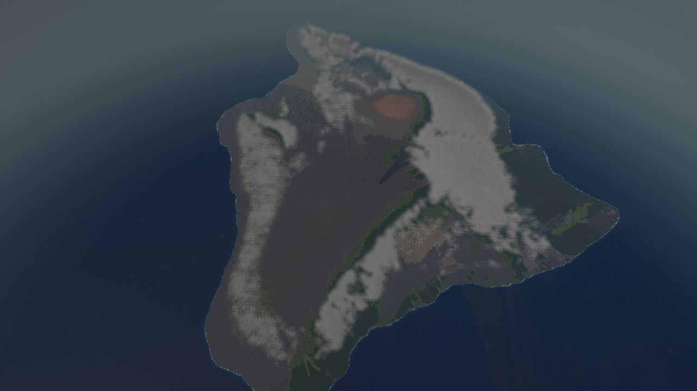

Alle Bilder hier sind mit `tools/Standbild` aus dem Projekt gerechnet, mit demselben Renderer wie die App
(in meiner Umgebung mit Software-Grafik; auf einer echten Grafikkarte sieht es gleich aus).

| | |
|---|---|
| 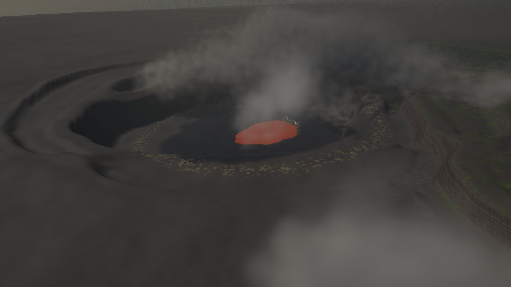 | 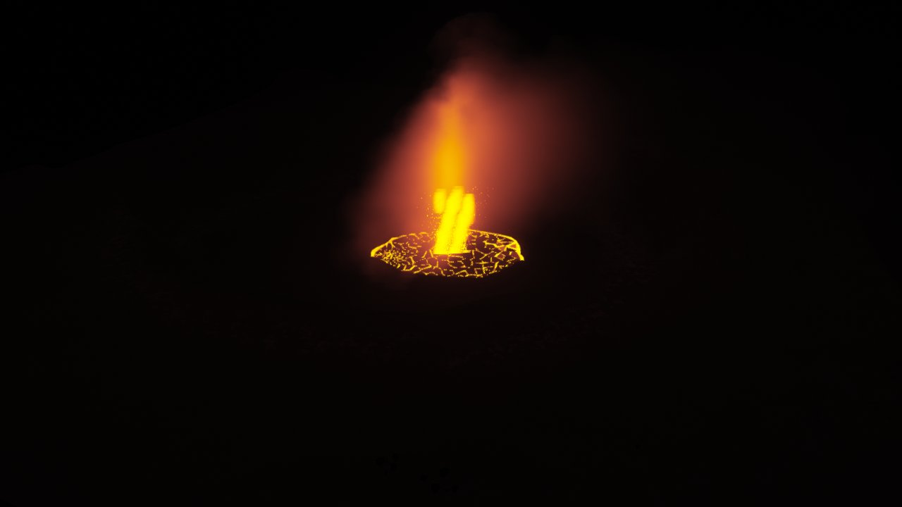 |
| Halemaʻumaʻu mit Lavasee, Ringstufen und Fahne | Fontäne im Halemaʻumaʻu, nachts |
| 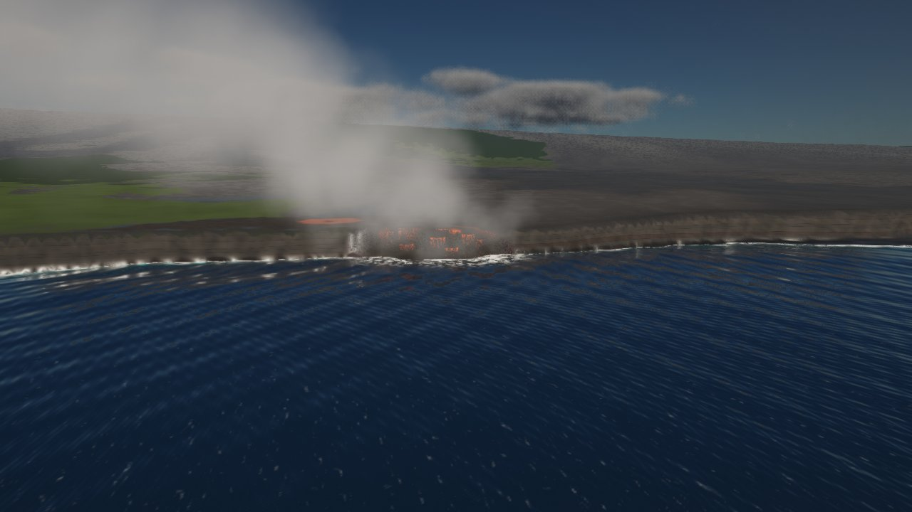 | 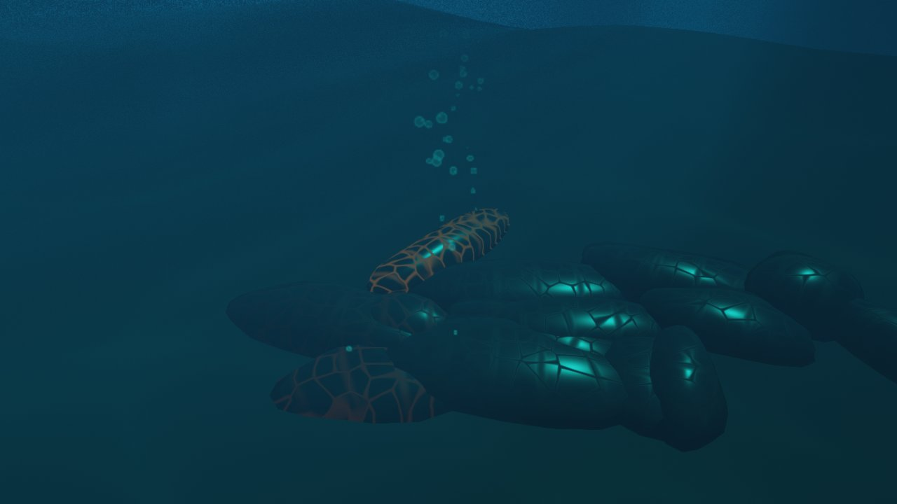 |
| Meereseintritt bei Kamokuna | Kissenlava in rund 9 m Tiefe |
| 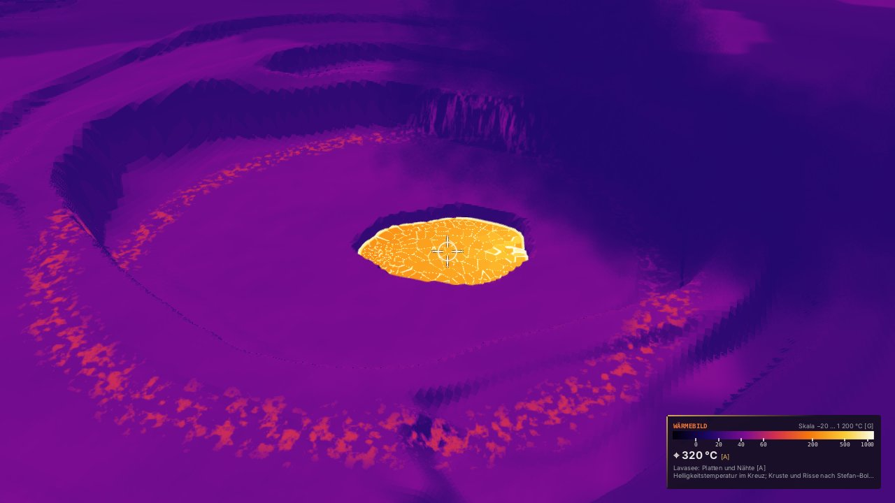 | 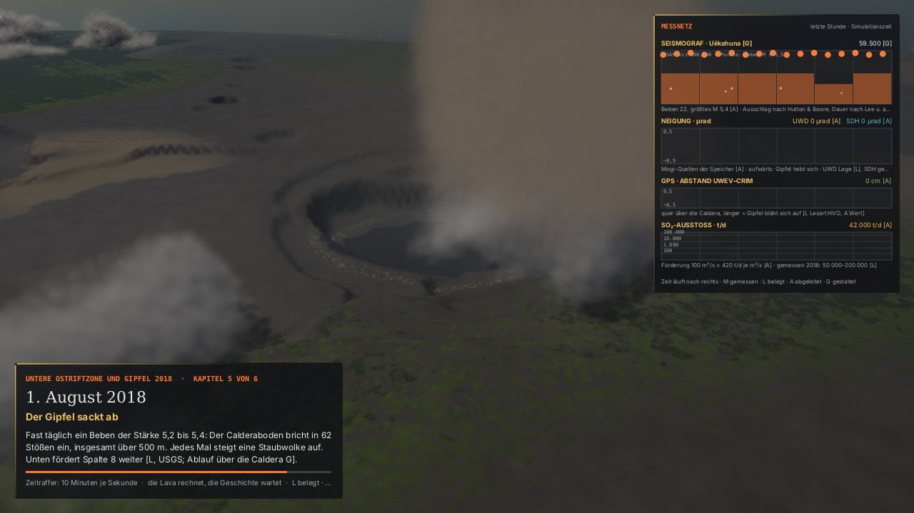 |
| Wärmebild des Lavasees | Drehbuch 2018: der Gipfel nach 62 Einstürzen, mit Messnetz |
| 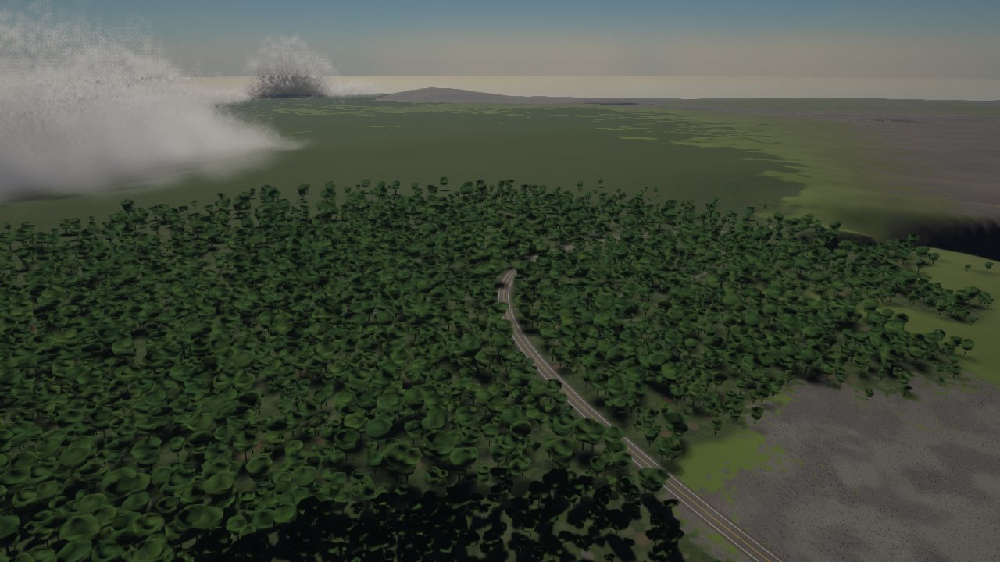 | 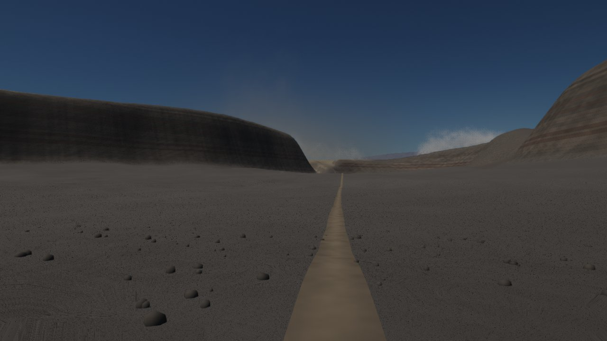 |
| Regenwald bei Nāhuku | Zu Fuß auf dem Kraterboden des Kīlauea Iki |
| 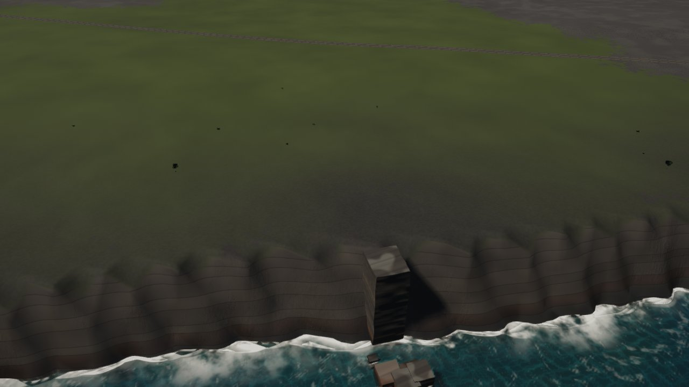 | 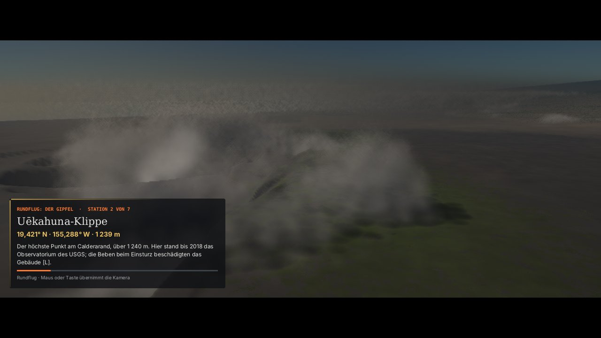 |
| Brandung an der Klippe bei Hōlei | Rundflug „Der Gipfel“ an der Uēkahuna-Klippe |

## Starten

**Voraussetzungen:** JDK 21 (oder neuer), eine Grafikkarte mit OpenGL 4.3 (entwickelt auf einer AMD Radeon 680M),
rund 4 GB Arbeitsspeicher für die App. Alle Bibliotheken liegen in `lib/` (JOGL und GlueGen 2.6.0 mit den Natives für
Windows x64, `FStyle.jar`, `ojdbc11.jar`, `sdoapi/sdogr/sdoutl.jar`).

1. In NetBeans **Clean and Build**. Das Jar heißt `dist/Kilauea.jar`.
2. **Run** in NetBeans, oder `Kilauea.bat` doppelklicken.
3. Einmal `Verknuepfung.bat` ausführen. Es legt an:
   - „Kīlauea“ auf dem Desktop und im Startmenü, mit dem Programmsymbol,
   - „Kīlauea Dauerlauf“ im Projektordner (startet die App und gleich den Dauerlauf, siehe unten).

   Das Skript prüft, ob Java 21 gefunden wird, und nimmt dieselben JVM-Schalter wie `Kilauea.bat`. Die alte
   Verknüpfung „Kilauea“ ohne Strich aus Phase 1 räumt es weg, wenn sie auf dieses Projekt zeigt.

Beim Start baut sich die Insel im Hintergrund auf (beim allerersten Start rund 10 s für den Zwischenspeicher
`data/gelaende_75m.bin`, danach unter einer Sekunde). Das Startbild zeigt den Stand der Datenbank und die letzte
Sitzung; nach 3 s geht es mit „Weiter wie zuletzt“ weiter.

Schalter für die JVM, wenn nötig: `-Dkilauea.gljpanel=true` (wenn das Bild schwarz bleibt), `-Dkilauea.klang=false`
(ohne Klang), `-Dkilauea.splash=false` (ohne Startbild), `-Dkilauea.dauerlauf=true` (Dauerlauf),
`-Dkilauea.fruehZ=false` (Gelände ohne frühen Tiefentest, zum Vergleichen).

## Bedienung

| Taste, Maus | Was |
|---|---|
| Links ziehen · rechts ziehen · Rad | drehen · verschieben · zoomen |
| W A S D (Umschalt: schneller) | gleiten oder gehen; das Tempo folgt der Höhe über Grund |
| Pfeiltasten | drehen |
| Pos1 | die ganze Insel |
| 1 bis 9 | Orte: Halemaʻumaʻu, Caldera, Uēkahuna, Kīlauea Iki, Nāhuku, Mauna Ulu, Puʻu ʻŌʻō, Hōlei, Kamokuna |
| R · G | kreisen · gehen oder fliegen |
| T · I | Wärmebild · „Was liegt hier?“ |
| M · V | Klang an oder aus · Blick als Ansicht merken |
| F1 · F12 · F5 | alle Tasten · Foto · Shader neu laden |

Das Bedienfeld rechts hat 11 Blöcke zum Auf- und Zuklappen: Ansicht (19 Orte, eigene Ansichten), Zeit (Tag, Uhr,
Zeitraffer bis „Ein Tag in 90 Sekunden“), Rundflug (drei Touren), Ausbrüche (fünf Drehbücher nach echten
Vorbildern und der freie Ausbruch an jeder Stelle der Riftzonen), Lava (Modell), Unter der Oberfläche (Schnitt),
Messnetz und Wissen, Leben und Klang, Luft und Meer, Bild, Daten.

## Qualitätsstufen

| Stufe | Auflösung | Schattenkarten | Schattenproben | Bloom, FXAA | Feinrelief | Gelände fein bis | Anisotropie | Wolkenschritte | Pflanzen bis |
|---|---|---|---|---|---|---|---|---|---|
| Niedrig | 67 % | 1024² | 4 | aus | aus | 1,6 Knoten | 2-fach | 12 | 350 m, ohne Farne |
| Mittel | 85 % | 2048² | 8 | an | 60 % | 2,0 Knoten | 4-fach | 16 | 600 m |
| Hoch | 100 % | 2048² | 12 | an | voll | 2,5 Knoten | 8-fach | 28 | 800 m |
| Ultra | 100 % | 4096² | 12 | an | voll | 3,5 Knoten | 16-fach | 36 | 1 500 m |

„Auflösung selbst regeln“ (Block „Bild“) senkt die Auflösung in Schritten von 5 % bis auf die Hälfte, wenn die
Grafikkarte das Ziel nicht schafft, und hebt sie wieder bis zur Stufe. Ziel 30, 40 oder 60 Bilder/s; die Grafikkarte
soll höchstens 85 % der Zeit eines Bildes brauchen. Die Statuszeile zeigt Bilder/s und die Zeit der Grafikkarte, der
Block „Bild“ die Zeit je Durchgang (Schatten, Himmel+Boden, Straßen+Pflanzen+Figuren, Lavasee, Meer, Wolken, Dampf,
Fontäne, Nachbearbeitung) und je Teil des Prozessors.

Seit Phase 17 zeichnet die App das Gelände ohne `discard`, wenn kein Schnitt offen ist und kein Eingang der
Lavaröhre in der Nähe liegt. Dann prüft die Grafikkarte die Tiefe vor dem Shader, die Knoten kommen von vorn nach
hinten, und verdecktes Gelände kostet keine Rechnung je Bildpunkt. Der Gelände-Shader rechnet Farben nur dort, wo sie
mit Gewicht ins Bild gehen, und die Schatten nehmen alle Proben nur im Halbschatten.

## Dauerlauf

Der Knopf **„Dauerlauf (10 Minuten)“** im Block „Bild“ (oder die Verknüpfung „Kīlauea Dauerlauf“) lässt die App sich
selbst vorführen und prüfen:

| Abschnitt | Dauer |
|---|---|
| 1 Gipfel aus der Höhe, kreisend | 60 s |
| 2 Rundflug „Der Gipfel“ | 90 s |
| 3 Drehbuch „Fontänen im Halemaʻumaʻu 2024/25“ | 120 s |
| 4 Zu Fuß auf dem Boden des Kīlauea Iki | 60 s |
| 5 Wärmebild am Halemaʻumaʻu | 45 s |
| 6 Rundflug „Riftzone bis zum Meer“ | 90 s |
| 7 Ein Tag in 90 Sekunden über der Küste | 60 s |
| 8 Freier Ausbruch an der Ostriftzone | 75 s |

Jede Sekunde notiert sie Bilder/s, die Zeiten von Grafikkarte und Prozessor, das längste Bild, den Speicher und die
Zahl der Fäden. Am Ende stellt sie den Zustand von vorher wieder her (Kamera, Uhr, alle Schalter) und schreibt
`logs/dauerlauf_JJJJ-MM-TT_HHMM.txt` mit einer Tabelle je Abschnitt und dieser **Prüfliste**, dazu eine CSV-Datei mit
allen Sekunden und einen Eintrag ins Protokoll:

1. keine Fehlermeldung im Protokoll und keine der Grafik
2. kein Hänger: das längste Bild kürzer als 500 ms, höchstens 3 % der Sekunden mit einem Bild über 100 ms
3. Bilder/s im Mittel mindestens 25, keine Sekunde unter 12
4. Speicher nach dem Aufräumen am Ende höchstens 200 MB über dem Anfang
5. Fäden am Ende höchstens 3 mehr als am Anfang
6. Drehbuch und Ausbruch zu Ende geführt, der Spieler wieder in Ruhe
7. mit Datenbank: das Protokoll erreicht sie ohne Fehler

Die Schwellen sind gestaltet [G]. Am Ende steht „ERGEBNIS: alles in Ordnung“ oder die Zahl der offenen Punkte. Ein
zweiter Klick auf den Knopf bricht ab; der Bericht enthält dann, was bis dahin gemessen ist.

## Datenbank

Die App läuft ohne Datenbank (Zustand, Ansichten und Protokoll dann in `~/.kilauea/` und `logs/`). Mit Oracle 21c
legt der **Einrichter** (Startbild „Einrichten …“ oder Block „Daten“) im Schema `KILAUEA` 13 Tabellen mit dem Präfix
`KIL_` an, dazu die Pakete `KIL_API` und `KIL_WISSEN`, und lädt die Grunddaten: 19 Orte, 14 Krater mit Rand, 49 Ströme
und Flächen mit Umriss, 12 Stationen, 6 Drehbücher mit 29 Kapiteln (SRID 8307, in QGIS direkt als Ebenen). Die App
schreibt Sitzungen, Zustand, Ansichten, Protokoll und jeden Lauf eines Drehbuchs mit Beben und Messnetz.
`KIL_WISSEN.wo_liegt(breite, laenge)` ist „Was liegt hier?“ als SQL. Einzelheiten in [db/README.md](db/README.md).

## Werkzeuge

Alle laufen ohne Fenster aus dem Projektordner (Klassenpfad `build/classes` und `lib/*`):

| Werkzeug | Was |
|---|---|
| `test/…/Pruefung` | das Prüfprogramm, ohne Grafikkarte und Datenbank; muss „ERGEBNIS: alles in Ordnung“ melden |
| `tools/Standbild <ordner> <b> <h> [namen …]` | Standbilder mit demselben Renderer (so sind die Bilder hier entstanden) |
| `tools/Tempo bild <ort> <b> <h> <bilder> [png] [stufe]` | Zeit je Bild und je Durchgang an einem festen Ort (`iki`, `rand`, `wald`, `hoehe`) |
| `tools/TourLauf` | fliegt alle Touren, Orte und Drehbuchblicke ab und zählt Sprünge, Kollisionen, Blicke durchs Gelände |
| `tools/DrehbuchLauf`, `tools/MessLauf` | Drehbücher ohne Fenster, mit Vergleich vorher/nachher und dem Messnetz je Kapitel |
| `tools/LavaLauf`, `tools/MagmaLauf` | Lava- und Magmamodell ohne Grafik, mit Karte und Verlauf |
| `tools/Tageslauf` | ein Tag in 90 Sekunden mit Helligkeit, Flackern und ausgebrannten Bildpunkten |
| `tools/LebenLauf`, `tools/KlangProbe` | Figuren eines Tages im Park; Hörproben als WAV |
| `tools/OberflaecheLauf setzen\|pruefen` | die echte App: Zustand einstellen, sichern, neu starten, vergleichen |
| `tools/Grunddaten` | schreibt `db/06_grunddaten.sql` aus dem Code |

## Ordner

| Ordner | Inhalt |
|---|---|
| `src/com/dan/kilauea/` | `app`, `render` (+ `shader`), `terrain`, `flora`, `lava`, `magma`, `sea`, `atmos`, `script`, `camera`, `monitor`, `life`, `sound`, `db`, `ui`, `tools` |
| `src/com/dan/` | `forest`, `ground`, `river`, `road` (aus Geyser übernommen) |
| `data/` | Detailkacheln und der Zwischenspeicher des Geländes (wird gebaut) |
| `N18W156`, `N19W155`, `N19W156`, `gt30w180n40.tif` | Höhendaten (GLSDEM, GTOPO30) |
| `db/` | SQL-Skripte, Zugang, Berichte des Einrichters |
| `docs/` | Datenquellen, `bilder/` mit den 11 Bildern dieses README |
| `icon/` | Programmsymbol |
| `logs/` | Tagesprotokolle und Berichte der Dauerläufe |

## Grenzen

Was das Modell bewusst oder noch nicht kann, ehrlich aufgeschrieben (Einzelheiten im Werkbuch):

- Gelände aus SRTM vom Februar 2000 mit gestalteten Änderungen bis 2018; der Norden (Mauna Kea Nord, Kohala) aus
  GTOPO30 in 1 km. Der Meeresboden ist gestaltet, Kraterwände sind geschärft, nicht gemessen.
- Die Wege der Ströme sind gerechnet, nicht die geologische Karte. Lava- und Magmamodell sind qualitativ.
- Röhren kühlen schneller als gemessen. 2018 erreicht die Lava des Modells Kapoho nicht, das Delta bei Kamokuna
  bleibt klein. Die Raten der Fontänen-Episoden sind erzählt, darum ist das SO₂ der Episoden kleiner als gemessen.
- Die Zeit der Drehbücher ist erzählt. Seismometer tragen keine echten Kürzel, das Wärmebild sieht durch Dampf.
- Figuren sind schlicht; Wolken aus der Nähe leicht körnig; der Meeresgrund dunkel; Gischt eher Wolke als Strahl;
  die Kehren der Chain of Craters Road an der Hōlei Pali sind nicht ausgeformt.
- Der Felsbogen Hōlei ist seit September 2026 eingestürzt; die App zeigt den Stand heute, der Bogen bleibt als Schalter.

---
NetBeans-Projekt `Kilauea`, Paket `com.dan.kilauea`. Plan und Fortschritt stehen im **Kīlauea Werkbuch**.
